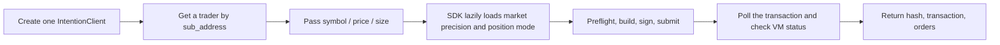

# Intention Python SDK integration guide

This guide is for integrators building trading services, quantitative programs,
scripts and backend applications. It covers the integration path the Intention
Python SDK currently recommends, what it simplifies compared with the earlier
approach, and how to keep using the fine-grained clients, the pure builders and
the low-level transaction objects.

It covers user-level capabilities only. Under the unified entry point, vaults are
read-only and there are no vault transaction shortcuts; admin and system
configuration are out of scope.

## 1. Which integration path to choose

| Situation | Entry point | What the SDK does |
| --- | --- | --- |
| Backend, quantitative program or script, with as little code as possible | `IntentionClient` + `trader()` | configuration, signing, market precision, building, submission, polling, event decoding |
| Only accounts, agents, transfers and leverage | `sdk.accounts` | building, signing, submission, polling, event decoding |
| An existing `OrderClient` / `AccountClient` integration | keep using those clients | preserves your dependency injection and lifecycle |
| An external signer or a custom submission service | `OrderIntents` / `AccountIntents` | builds the transaction only; the caller signs and submits |
| Full control over nonces, wire units and payloads | the `Dex*` payload classes | the caller orchestrates everything |

New integrations should start with the first row. The unified entry point does
not replace or remove the lower-level APIs; it is a facade over them. An existing
integration keeps working as it is, and can migrate gradually.

## 2. What the unified entry point simplifies

The earlier approach usually left the caller to do all of this:

1. Create `Intention`, `RestClient`, `DexTransactionExecutor`, `OrderClient`,
   `AccountClient` and the query clients separately.
2. Keep the signer, node, relayer and WebSocket configuration in several places.
3. Fetch market configuration from the relayer and construct a `MarketResolver`.
4. Read the subaccount's position mode.
5. Convert human-readable `price` / `size` into `subticks` / `quantums`.
6. Build `DexOrders`, wrap it in an orderless transaction, sign and submit.
7. Poll on-chain state by transaction hash and check the VM execution result.
8. Decode the order events to see whether each order was accepted or rejected.

The unified entry point collapses that into:



`trader()` itself issues no requests. Market configuration and position mode are
loaded lazily on first use and cached, or can be loaded up front with
`prepare()`.

## 3. URL configuration and where data comes from

Pass the URLs for your environment explicitly. `Network` is currently only a
label and does not fill them in.

| Setting | How strongly recommended | Purpose | Effect when missing |
| --- | --- | --- | --- |
| `node_url` | required | chain id, submitting and polling transactions, account and position queries | `IntentionClient` refuses to initialize |
| `relayer_url` | required for trading | `/v1/perpetualMarkets`, dynamic preflight, open orders | market precision cannot be resolved automatically; `cancel_all` cannot discover orders |
| `ws_url` | optional | real-time market and account subscriptions | does not affect ordinary order placement or confirmation |
| `faucet` | optional | test-environment funding | affects the faucet methods only |
| `indexer` | optional | reserved for indexer queries | does not affect the flow in this guide |

`fullnode` is a backward-compatible alias for `node_url`; new code should use
`node_url`.

A market's `symbol_id`, `atomic_resolution`, `quantum_conversion_exponent`,
`step_base_quantums` and `subticks_per_tick` come from:

```text
GET {relayer_url}/v1/perpetualMarkets
```

so the caller does not have to pass `subticks_per_tick` and friends to every
`place_order()` call. `sdk.markets.get_resolver()` fetches the ACTIVE markets on
first use and caches them:

```python
resolver = await sdk.markets.get_resolver()

# Refresh after a market is added or its precision configuration changes.
refreshed = await sdk.markets.get_resolver(refresh=True)

# Or just clear the cache so the next use re-fetches.
sdk.markets.clear_cache()
```

If you already have a trusted market configuration, pass your own `resolver` to
`trader()` to skip the relayer request entirely.

## 4. The recommended minimal integration

The example assumes `signer` is already loaded securely on the server side and
`sub_address` exists:

```python
from intention_sdk import IntentionClient
from intention_sdk.types.enums import OrderPositionMode, TimeInForce
from intention_sdk.transactions.order_intents import OrderInput, OrderType


async def place_limit_order(signer, sub_address):
    sdk = IntentionClient(
        signer=signer,
        node_url="https://node.example/v1",
        relayer_url="https://relayer.example",
        ws_url="wss://relayer.example/ws",
    )

    try:
        trader = sdk.trader(
            sub_address=sub_address,
            # Pass it when known, to skip the first account query.
            position_mode=OrderPositionMode.NET,
        )

        return await trader.place_order(
            OrderInput(
                symbol="BTC-USDC",
                side="BUY",
                type=OrderType.LIMIT,
                price="60000",
                size="0.01",
                client_order_id="strategy-a-20260724-0001",
            ),
            preflight="auto",
            timeout_secs=30,
            poll_interval_secs=1,
            throw_on_order_reject=True,
        )
    finally:
        await sdk.close()
```

The unified object's main namespaces:

| Entry point | Capabilities |
| --- | --- |
| `sdk.trader(sub_address=...)` | placing, modifying, cancelling and closing within one subaccount, plus position settings and queries |
| `sdk.accounts` | subaccounts, agents, transfers and cross-subaccount settings |
| `sdk.markets` | fetching market configuration and caching the resolver |
| `sdk.realtime` | the lazily created WebSocket client |
| `sdk.vaults` | read-only vault queries |
| `sdk.intention` | the underlying chain client, still available |
| `sdk.executor` | the underlying build, submit and poll orchestration, still available |

## 5. How `trader()` loads lazily

```python
trader = sdk.trader(
    sub_address=sub_address,

    # Optional. When provided, the on-chain position mode is not queried.
    position_mode=OrderPositionMode.NET,

    # Optional. When provided, market configuration is not fetched from the relayer.
    resolver=resolver,
)
```

Without `position_mode`, the subaccount is queried through `node_url` before the
first trade. Without `resolver`, market precision is fetched through
`relayer_url` before the first trade. Both are then cached on that `trader`.

To surface a configuration error at startup instead:

```python
trader = sdk.trader(sub_address=sub_address)
await trader.prepare()
```

After an external system changes the position mode or the market configuration:

```python
trader.refresh()
sdk.markets.clear_cache()
```

When the mode is changed through `trader.set_position_mode()`, the SDK clears the
current trader's cached position mode and its internal order client.

## 6. `price`, `size` and precision

The business APIs take human-readable values:

- `price`: `int | float | str`
- `size`: `int | float | str`
- `trigger_price`: `int | float | str`
- account amounts: `amount`, or the already-converted `amount_atomic`

Recommendations:

- A plain UI with short decimals can pass a number.
- On the server, from a database, or with large amounts or many decimal places,
  prefer a decimal string.
- Use `amount_atomic` only when a protocol integration already holds on-chain
  atomic units.
- Do not compute `subticks` in your own code; the resolver aligns to a valid
  tick and step using the market configuration.
- The Python resolver converts internally through `Decimal(str(value))`, but it
  is still better to avoid using a value that has been through several binary
  floating-point operations as the source of an amount.

`time_in_force` accepts only `TimeInForce.GTC`, `TimeInForce.IOC` or
`TimeInForce.ALO`. The client adapter handles defaults, post-only combination
checks and wire encoding; strings such as `"GTC"` are not accepted, and FOK, AON,
GTD and GTB are not yet exposed in the high-level order API.

For example:

```python
await trader.place_order(
    OrderInput(
        symbol="BTC-USDC",
        side="BUY",
        type=OrderType.LIMIT,
        price=60_000,      # int
        size="0.010000",   # str
    )
)
```

## 7. Order methods

### 7.1 A single order

```python
result = await trader.place_order(
    OrderInput(
        symbol="BTC-USDC",
        side="BUY",
        type=OrderType.LIMIT,
        price="60000",
        size="0.01",
        time_in_force=TimeInForce.GTC,
        client_order_id="entry-001",
    )
)
```

Supported order types:

- `LIMIT`
- `MARKET`
- `STOP_LIMIT`
- `STOP_MARKET`
- `TAKE_PROFIT_LIMIT`
- `TAKE_PROFIT_MARKET`

Market orders default to IOC and everything else to GTC. `post_only=True` is
equivalent to ALO and is only valid on a limit order.

### 7.2 Several order groups in one transaction

In Python a single-order group is just an `OrderInput`; a composite group uses
the matching dataclass:

```python
from intention_sdk.transactions.order_intents import BracketOrderGroup, TpSlLeg

result = await trader.place_orders(
    [
        OrderInput(
            symbol="BTC-USDC",
            side="BUY",
            type=OrderType.LIMIT,
            price="59000",
            size="0.01",
            client_order_id="grid-01",
        ),
        OrderInput(
            symbol="BTC-USDC",
            side="BUY",
            type=OrderType.LIMIT,
            price="58000",
            size="0.01",
            client_order_id="grid-02",
        ),
    ]
)
```

This is not the client sending two transactions in a loop; it is one transaction
carrying several order groups. The `orders` in the result aggregate each order's
final state from the events.

### 7.3 An entry order with attached TP/SL

```python
from intention_sdk.transactions.order_intents import TpSlLeg

result = await trader.place_order_with_tpsl(
    OrderInput(
        symbol="BTC-USDC",
        side="BUY",
        type=OrderType.MARKET,
        size="0.01",
        client_order_id="entry-002",
    ),
    tp=TpSlLeg(
        type=OrderType.TAKE_PROFIT_MARKET,
        trigger_price="65000",
        client_order_id="entry-002-tp",
    ),
    sl=TpSlLeg(
        type=OrderType.STOP_MARKET,
        trigger_price="57000",
        client_order_id="entry-002-sl",
    ),
    preflight="full",
    throw_on_order_reject=True,
)
```

`place_order_with_tp_sl()` is a readability alias for the same method. The entry,
TP and SL go into one transaction as a related group, rather than the client
placing the entry first and attaching TP/SL separately afterwards.

### 7.4 TP/SL for an existing position

```python
await trader.place_position_tpsl(
    symbol="BTC-USDC",
    position_side="LONG",  # required in hedge mode; may be None in net mode
    size_mode="close_position",
    tp=TpSlLeg(
        type=OrderType.TAKE_PROFIT_MARKET,
        trigger_price="65000",
    ),
    sl=TpSlLeg(
        type=OrderType.STOP_MARKET,
        trigger_price="57000",
    ),
    preflight="full",
)
```

`place_position_tp_sl()` is an alias. `size_mode="close_position"` covers the
whole position; `size_mode="fixed"` requires a `config_amount`.

### 7.5 References for modifying and cancelling

An `OrderRef` can be an on-chain `order_id` or a `client_order_id` you set
earlier:

```python
from intention_sdk.transactions.order_intents import ModifyChanges, OrderRef

await trader.modify_order(
    OrderRef(client_order_id="entry-001"),
    ModifyChanges(
        symbol="BTC-USDC",
        price="60500",
        size="0.02",
        new_client_order_id="entry-001-r1",
    ),
)

await trader.cancel_order(OrderRef(order_id=123456))
await trader.cancel_order(OrderRef(client_order_id="entry-001-r1"))
```

`client_order_id` is not a free-form note. It is a caller-defined order
identifier used to correlate results, query, modify and cancel. Keep it unique
within the idempotency scope your business needs, and persist it.

A plain `modify_order()` can only change size, price and the new client order id.
Trigger settings on a conditional order need `modify_condition_order()`; when the
change cannot be expressed as an on-chain replace, cancel and place a new order
instead.

For backward compatibility, Python's `ModifyChanges` keeps wire-unit semantics
when `symbol` is omitted. New integrations should pass `symbol` so the SDK
converts human-readable price and size.

### 7.6 Cancel-all and close-all

```python
await trader.cancel_all()                    # needs relayer_url
await trader.cancel_all(symbol="BTC-USDC")  # needs relayer_url

await trader.close_position(
    symbol="BTC-USDC",
    size="ALL",
    order_type=OrderType.MARKET,
)
```

`cancel_all` first discovers open orders from the relayer, and `size="ALL"` first
reads the exact position quantums from the node, so neither is a purely local
build.

## 8. Accounts, agents and funding

### 8.1 Creating a subaccount

```python
created = await sdk.accounts.create_subaccount(
    "trading",
    timeout_secs=30,
)

print(created.hash, created.transaction, created.events)

# Python currently returns information through the confirmed events and an
# account query; for the latest account list:
accounts = await sdk.accounts.get_accounts()
```

The create method waits for confirmation and returns a `DexExecutionResult`. The
Python facade does not add a `sub_address` field today; decode it from `events`
or confirm it with `get_accounts()`.

### 8.2 Position mode, margin mode and leverage

```python
await trader.set_position_mode("one-way")

await trader.set_margin_mode(
    [{"symbol": "BTC-USDC", "mode": "isolated"}]
)

await trader.set_leverage(
    [{"symbol": "BTC-USDC", "leverage": "10"}]
)

await trader.adjust_isolated_margin(
    symbol="BTC-USDC",
    side="long",
    action="add",
    amount="100",
)
```

The same operations are available through `sdk.accounts` with an explicit
`sub_address`. When you pass a `symbol`, the SDK resolves `symbol_id` through the
resolver; when you already know the on-chain id, pass `symbol_id` directly.

### 8.3 Agents

```python
agent = sdk.accounts.generate_agent_account()

await sdk.accounts.approve_agent(
    "trading-agent",
    agent,
    expires_in_secs=30 * 24 * 60 * 60,
)

await sdk.accounts.revoke_agent("trading-agent")
```

`generate_agent_account()` only creates the account; it does not custody the
generated private key. The caller must store it securely and must not write it to
logs, analytics or an ordinary configuration file.

### 8.4 Transfers

```python
await sdk.accounts.transfer_between_subaccounts(
    from_sub_address,
    to_sub_address,
    amount="10.5",
    decimals=6,
)

await sdk.accounts.deposit_to_subaccount(
    sub_address,
    amount="100",
)

await sdk.accounts.withdraw_to_main(
    sub_address,
    amount="25",
)
```

Human-readable amounts default to 6 decimals (USDC). A protocol integration that
already holds atomic amounts should use `amount_atomic`, and must not pass
`amount` at the same time.

### 8.5 Multisig accounts

An account can be controlled jointly by a group of owners under a threshold. The
chain keeps one optional authority record per account: with no record (the vast
majority of accounts) the key the address derives from is in control; when the
record is a `policy`, the account's own key cannot sign for it, and operations
that move funds or grant authority must carry enough owner signatures to meet the
threshold.

This SDK provides **construction and digests**, not wallet dialogs; the document
rendered for a wallet lives in the TypeScript SDK.

```python
from intention_sdk import (
    DexMultisigTx, DexOrderlessTx, DexOrderlessTxVariant, GatedPayload,
    MultisigOpCreate, MultisigOpExecute, MultisigProof,
    approval_digest, create_approval_digest, derive_multisig_account_address,
    evm_signature_from_compact, multisig_operation_id, validate_multisig_policy,
)

owners = ["0xa1a1...a1", "0xa2a2...a2", "0xa3a3...a3"]   # 20-byte EVM addresses
assert validate_multisig_policy(owners, 2) is None        # same shape checks as on chain

salt = os.urandom(32)
account = derive_multisig_account_address(creator, salt)   # funding address, computable before any transaction
op = MultisigOpCreate(owners, 2, salt)

op_id = multisig_operation_id(chain_id, account, 0, op, expires_at_secs)   # epoch is 0 at creation
digest = create_approval_digest(chain_id, account, creator, op, expires_at_secs, op_id)
# Hand the digest to two owners' wallets and collect 65-byte signatures
proof = MultisigProof(op_id, 0, expires_at_secs, [evm_signature_from_compact(s) for s in sigs])

payload = DexOrderlessTx(
    DexOrderlessTxVariant.MULTISIG, DexMultisigTx(envelope_nonce, account, op, proof)
)
```

Converting an existing account and the day-to-day operations follow the same
shape: `MultisigOpInstall` / `MultisigOpUpdatePolicy` / `MultisigOpRemove` /
`MultisigOpRotateKey`, and `MultisigOpExecute(GatedPayload....)` for the four gated
kinds (transfers, vaults, agents, creating a subaccount). A few rules that are
easy to get wrong:

- `approval_digest()` returning `None` does not mean "not supported yet"; it is a
  **refusal**. The operation cannot be rendered in a wallet as something a human
  can read (an asset id not in the table, an address whose top 12 bytes are
  non-zero, an empty batch), or it is not an operation owners should sign at all
  (`Create` uses `create_approval_digest`, and `RotateKey` is authorized by the
  account's own key). The chain refuses the same inputs.
- **Revoking an agent also needs the threshold**: both
  `Execute(DexAgent::Revoke)` and the new `DexAgentTx.revoke_all(nonce)` require
  k-of-n, and without a proof they are rejected in the mempool. `revoke_all`
  clears every authorization in one transaction, which is what brings revocation
  back to a single round of signatures now that it goes through the threshold;
  its JSON discriminator is `revoke_all`, not a `revoke` with an empty name.
- `Remove` and `RotateKey` **clear every agent authorization on the account**.
  Resting orders are unaffected and must be cancelled by whoever controls the
  account now.
- Multisig transactions can **only** be submitted over BCS; the JSON submission
  path rejects them outright.
- Reading state: `await dex_account_client.get_authority(account)` (returning
  `None` means no record, that is, control by the key the address derives from -
  not an error) and
  `await dex_account_client.is_multisig_operation_used(op_id)`, which tells
  "already executed" apart from "my submission was lost" and accepts either hex
  or the bytes returned by `multisig_operation_id()`.
- Two new events, `decode_authority_changed_event` and
  `decode_multisig_operation_executed_event`. Neither carries the owner list,
  only an `owners_digest`; recompute it with `multisig_owners_digest(owners)` to
  compare.

The cross-language fixed vectors are `multisig_signing_vectors.json` in the
chain, and `tests/testdata/` here holds a copy.
`test_multisig_vectors.py` reproduces, byte for byte, the BCS, operation id and
approval digest of 18 operations, plus the derived address, the challenge digest
and the whole envelope. Changing any one of those bytes invalidates every owner
signature already collected.

## 9. Executing methods and submit-only methods

Each major user operation comes in two forms.

### 9.1 Executing: the default recommendation

A method without the `submit_` prefix will:

1. Run the preflight.
2. Build, sign and submit.
3. Poll the transaction through the node.
4. Check VM execution success.
5. Decode the DEX events.
6. Return the confirmed result.

Order methods return:

```python
@dataclass(frozen=True)
class OrderActionResult:
    hash: str
    transaction: dict
    orders: list[OrderOutcome]
    all_accepted: bool | None
```

Each `OrderOutcome` carries:

- `status`: `placed` / `filled` / `cancelled` / `amended` / `rejected`
- `order_id`
- `client_order_id`
- `symbol_id`
- `reject_reason_code`

What `all_accepted` means:

- `True`: order results were decoded and none was rejected.
- `False`: at least one order was rejected by the DEX business layer.
- `None`: the transaction was confirmed, but no recognizable order-result event
  was decoded. This is not the same as accepted.

When you do not need the order events parsed, pass `include_orders=False`:

```python
result = await trader.place_order(order, include_orders=False)
assert result.orders == []
assert result.all_accepted is None
```

Account-level executing methods return
`DexExecutionResult(hash, transaction, events)`.

### 9.2 Submit-only: low latency or custom orchestration

A `submit_*` method waits only for the node to accept the transaction, not for
on-chain confirmation:

```python
pending = await trader.submit_order(
    OrderInput(
        symbol="BTC-USDC",
        side="SELL",
        type=OrderType.LIMIT,
        price="70000",
        size="0.01",
    ),
    preflight="local",
)

print(pending.hash)

transaction = await sdk.wait_for_transaction(
    pending.hash,
    timeout_secs=60,
    poll_interval_secs=1,
    check_success=True,
)
```

How to choose:

- You need a definite result to hand back to a caller: use an executing method.
- You already have a transaction queue, poller or async callback: use `submit_*`.
- You need confirmation but not the order events: use an executing method with
  `include_orders=False`.

## 10. Order preflight

`preflight` has three modes:

| Mode | Behaviour |
| --- | --- |
| `"local"` | checks only what can be decided locally: fields, types, combinations and market precision |
| `"full"` | must fetch dynamic market data, and checks TP/SL direction, reference price, strategy limits and so on |
| `"auto"` | full when a provider is available, otherwise local; the default for executing order methods |

`submit_*` defaults to local so that the submit-only path does not wait on
dynamic data. If your business requires conditional orders to be validated
dynamically, pass `preflight="full"` explicitly.

Python creates a full preflight provider by default when both `node_url` and
`relayer_url` are present. If full is requested explicitly but no provider is
available, an `OrderPreflightError` with code
`PREFLIGHT_PROVIDER_UNAVAILABLE` is raised before submission.

Common preflight problems:

- an unknown market, or a missing resolver
- a limit order with no price, or a conditional order with no trigger price
- a price or size that is invalid, non-positive, or cannot be aligned to tick/step
- hedge mode with no `position_side`
- `post_only` conflicting with market or IOC
- an incorrect TP/SL type or direction
- a missing or stale reference price
- a conditional limit price outside the allowed band

To bound how old the reference price may be:

```python
await trader.place_order_with_tpsl(
    entry,
    tp=tp,
    sl=sl,
    preflight="full",
    max_price_age_ms=5_000,
)
```

A failed preflight happens before submission, so it produces no transaction hash
and consumes no on-chain gas.

## 11. Error handling

### 11.1 The recommended single catch block

```python
from intention_sdk.api.client import ApiError
from intention_sdk.api.dex_executor import (
    TransactionExecutionError,
    TransactionTimeoutError,
)
from intention_sdk.api.order_client import OrderRejectedError
from intention_sdk.transactions.order_intents import OrderPreflightError


async def safe_place(trader, order):
    try:
        return await trader.place_order(
            order,
            preflight="full",
            timeout_secs=30,
            throw_on_order_reject=True,
        )
    except OrderPreflightError as exc:
        # Not submitted. Map code/field to a user-facing message; retrying after
        # fixing the parameters is safe.
        for issue in exc.issues:
            print(issue.code, issue.field, issue.message)
        raise
    except OrderRejectedError as exc:
        # The transaction itself may have succeeded while the order was rejected
        # by a DEX business rule.
        print(exc.result.hash, exc.rejected_orders)
        raise
    except TransactionExecutionError as exc:
        # The transaction was included but VM execution failed.
        print(exc.txn_hash, exc.transaction.get("vm_status"))
        raise
    except TransactionTimeoutError as exc:
        # State unknown: the transaction may still succeed later, so do not
        # blindly resubmit.
        print(exc.txn_hash, exc.timeout_secs)
        raise
    except ApiError as exc:
        # A node HTTP/API error.
        print(exc.status_code, str(exc))
        raise
    except (TypeError, ValueError):
        # A build parameter, local format or configuration error.
        raise
```

Relayer queries go through `httpx`, so market and preflight requests may also
raise `httpx.HTTPStatusError`, `httpx.TimeoutException` or another
`httpx.HTTPError`.

### 11.2 Error categories and recovery

| Stage | Typical error | Is there a hash yet | Suggestion |
| --- | --- | --- | --- |
| local build | `TypeError` / `ValueError` | no | fix the input; do not retry the same parameters |
| order preflight | `OrderPreflightError` | no | fix per `issues` and retry |
| node submission | `ApiError` or a network error | sometimes | check whether you got a hash; when unclear, query the account or the order |
| relayer request | `httpx.HTTPError` | no | check the URL, the auth headers and the service status |
| wait timeout | `TransactionTimeoutError` | yes | keep querying the same hash; do not resubmit before confirming |
| VM failure | `TransactionExecutionError` | yes | read the transaction and VM status, fix the cause, create a new transaction |
| DEX rejection | `OrderRejectedError` or `all_accepted is False` | yes | read `reject_reason_code` and handle per your rules |
| no order event | `all_accepted is None` | yes | keep the transaction and verify by hash or through the order query API |

Worth stressing: **a successful transaction and a successful order are not the
same thing**. A transaction can be submitted and executed successfully while the
DEX still rejects one or more of its orders through `OrderRejectedEvent`.

### 11.3 Whether a rejection should raise

The default is `throw_on_order_reject=False`, leaving the caller to inspect the
result:

```python
result = await trader.place_orders(groups)
if result.all_accepted is False:
    rejected = [item for item in result.orders if item.status == "rejected"]
```

A server-side RPC style usually prefers it on:

```python
await trader.place_orders(groups, throw_on_order_reject=True)
```

Either way, `OrderRejectedError.result` keeps the hash, the full transaction and
every order result.

### 11.4 Timeouts and retries

A timeout only means the SDK did not observe a final state within the deadline;
it does not mean the transaction failed. The recommended flow:

1. Persist the `txn_hash` and the `client_order_id`.
2. Keep calling `sdk.wait_for_transaction()` or a node query with the original
   hash.
3. At the same time, query the order by `client_order_id` so a lost response does
   not lead to a duplicate order.
4. Create a new transaction only after confirming the original was not accepted,
   has expired, or definitely failed.

Do not retry every error unconditionally. In particular, when the server received
the submission but the client lost the connection, a blind retry can produce a
duplicate order.

## 12. The earlier integration paths still work

### 12.1 Using `OrderClient` directly

Suitable for projects that already have dependency injection, a resolver cache or
custom providers:

```python
from intention_sdk.api.order_client import OrderClient

resolver = await sdk.markets.get_resolver()

orders = OrderClient(
    executor=sdk.executor,
    signer=sdk.signer,
    sub_address=sub_address,
    position_mode=OrderPositionMode.NET,
    resolver=resolver,
    node_url=sdk.config.node_url,
    relayer_url=sdk.config.relayer_url,
    headers=sdk.headers,
    preflight_provider=custom_preflight_provider,
    account_provider=custom_account_provider,
    open_orders_provider=custom_open_orders_provider,
)

result = await orders.place_order(order)
```

This is not deprecated. The unified facade creates an `OrderClient` internally in
the same way.

### 12.2 Pure builders: external signing or custom submission

```python
from intention_sdk.transactions.order_intents import OrderIntents, OrderIntentsContext

resolver = await sdk.markets.get_resolver()
builder = OrderIntents(
    OrderIntentsContext(
        sub_address=sub_address,
        position_mode=OrderPositionMode.NET,
        resolver=resolver,
    )
)

dex_orders = builder.place_order(
    OrderInput(
        symbol="BTC-USDC",
        side="BUY",
        type=OrderType.LIMIT,
        price="60000",
        size="0.01",
    )
)

pending = await sdk.executor.submit_orders(dex_orders)
```

Account operations can build a `DexOrderlessTx` with `AccountIntents`. The caller
can hand what is built to a custom signer, a hardware signer or a separate
transaction service.

### 12.3 Fully low-level payloads

Existing code using these types can stay as it is:

- `DexPlaceOrder`
- `DexPlaceOrders`
- `DexCancelOrder`
- `DexReplaceOrder`
- `DexConditionReplaceOrder`
- `DexOrders`
- `DexTx`
- `DexOrderlessTx`

This suits protocol integrations, replay tooling and services that already hold
wire units. The cost is that the caller must guarantee:

- `symbol_id` is correct.
- quantums and subticks are aligned to step and tick.
- the position mode and the signed-quantums semantics are correct.
- the nonce, gas and expiration are correct.
- signing, submission, polling, the VM check and event decoding are all handled.

## 13. Migration reference

| Earlier code | Unified entry point |
| --- | --- |
| `Intention(IntentionConfig(...))` | `sdk.intention` |
| keeping the signer yourself | `sdk.signer` |
| creating `RestClient` by hand | `sdk.rest_client` |
| creating `DexTransactionExecutor` by hand | `sdk.executor` |
| fetching markets and building a resolver by hand | `sdk.markets.get_resolver()` |
| `DexAccountClient(...)` | `sdk.accounts.query` or `sdk.accounts.*` |
| `OrderClient(...)` | `sdk.trader(sub_address=...)` |
| `AccountClient(...)` | `sdk.accounts` |
| manual `submit + wait` | an executing method, without the `submit_` prefix |
| submit only | the matching `submit_*` method |
| instantiating the WebSocket client by hand | `sdk.realtime` |

Migration does not have to happen all at once. Unify the configuration and the
signer first while keeping your existing `OrderClient`, then switch to `trader`
once the behaviour matches.

## 14. Production recommendations

1. Create a small number of long-lived `IntentionClient` instances per service
   process or signer; do not create one per order.
2. Use a separate `trader` per subaccount, and reuse the trader for the same
   subaccount so the caches apply.
3. Set and persist a `client_order_id` for every business order.
4. Prefer full preflight in production for conditional orders and TP/SL.
5. Record the hash, client order id, subaddress, symbol and final outcome.
6. Count preflight failures, VM failures, DEX rejections and timeouts separately.
7. After a timeout, reconcile by the original hash rather than placing again.
8. Refresh the `sdk.markets` cache after a market listing or precision change.
9. Use WebSocket for timeliness, not as the only source of trade confirmation.
10. `await sdk.close()` on shutdown to release the HTTP and WebSocket resources.
11. Keep private keys in a secure server-side signer, never in logs, error
    reports or source code.
12. Vault transactions and admin/system configuration do not go through this
    unified user entry point.

## 15. Frequently asked questions

### Why can't I place an order by symbol with only the node configured?

The node handles chain transactions and account state, but listing configuration
such as `subticks_per_tick` and `step_base_quantums` comes from the relayer.
Configure `relayer_url`, or pass your own resolver to `trader()`.

### Is WebSocket required to place an order?

No. Placing, submitting and confirming all go over HTTP. `ws_url` is only for
real-time subscriptions.

### Does `place_order()` return a hash or the final state?

Both. It waits for confirmation and returns the `hash`, the full `transaction`,
the parsed `orders` and `all_accepted`. Use `submit_order()` when the hash is all
you need.

### Is `place_orders()` several transactions?

No. One call builds and submits one transaction containing several order groups.

### When should I use `client_order_id`?

For every business order. It is used for correlation, for reconciliation after an
error, and for modifying or cancelling by client order id. `order_id` is the
identifier the chain and matching engine produce.

### Can I retry right after a timeout?

Not on the assumption that it failed. The original transaction may confirm later,
so query by hash and `client_order_id` first.

### Why would `all_accepted` be `None`?

The transaction was confirmed but the node's events contained no recognizable
order outcome, or the call passed `include_orders=False`. Keep the transaction and
verify through the query APIs; do not treat `None` as success.
